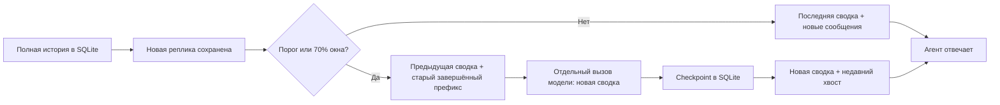

# Сжатие контекста диалога

Помимо Summary, приложение поддерживает режимы Sliding Window, Sticky Facts и «Выключено». Их сравнение на одном сценарии описано в [документе сравнения стратегий](context-strategy-comparison.md); разделы ниже подробно описывают Summary.

Приложение хранит полную историю диалога, но не обязано отправлять её целиком при каждом обращении к модели. Когда история достигает заданного порога, сервер создаёт краткую сводку старых сообщений и передаёт модели эту сводку вместе с недавними сообщениями. Сводка помогает удерживать длинный разговор в контекстном окне и может уменьшить расход входных токенов на последующих запросах.

Сжатие не гарантирует дословного сохранения каждого факта: сводку пишет модель, а очень длинные старые результаты инструментов ограничиваются ещё до её вызова. Полные исходные сообщения продолжают храниться в SQLite и отображаться в диалоге. О сохранении истории читайте в [документации по сессиям](chat-session-persistence.md), о фактических токенах и рублёвой оценке — в [документации по стоимости](token-accounting.md).

## Две версии истории

Сервер ведёт два представления одного диалога:

| Представление | Содержимое | Назначение |
| --- | --- | --- |
| Полная история | Все сохранённые пользовательские сообщения, ответы и части вызовов инструментов | Восстановление диалога, интерфейс и продолжение после перезапуска. |
| Контекст для модели | Последняя сводка старой истории и сообщения после неё | Вход очередного вызова модели. |

Сводка добавляется к входу модели как служебное пользовательское сообщение с пометкой `[Historical conversation summary]`. Она не записывается в таблицу `messages` как обычная реплика и не появляется в ленте сообщений. В интерфейсе её можно раскрыть в карточке «Сжатие контекста» рядом с пользовательским запросом, который запустил сжатие.

## Память вне истории

Перед выбором стратегии сервер добавляет к контексту отдельные блоки рабочего и долговременного слоя, если для текущего диалога есть включённые записи. Они не участвуют в счётчике сообщений, не записываются в `messages`, сводку или диагностический лог и получают собственные бюджеты, которые настраиваются на странице [памяти агента](agent-memory.md). Краткосрочный слой остаётся историей этой сессии и подчиняется выбранной стратегии ниже.

Сжатие не переносит записи в рабочую или долговременную память. Очистка диалога удаляет его историю и производные сводки/Sticky Facts, но ранее сохранённые самостоятельные записи проекта и факты не удаляет; после очистки они снова могут попасть в новый диалог проекта по обычным правилам отбора.

## Настройки

Управление находится в левой панели чата. Браузер сохраняет переключатель и порог сообщений локально, а размер окна — отдельно для каждого ID модели. При каждом новом запросе и продолжении браузер отправляет серверу снимок текущих настроек; сервер сохраняет его в `turns.agent_config_json.contextCompaction`.

| Настройка | По умолчанию | Как действует |
| --- | --- | --- |
| «Сжимать старую историю» | Включено | Разрешает создавать новые сводки. Выключение не удаляет уже созданные checkpoints. |
| «Порог сжатия, сообщений» | 20 | Запускает проверку по числу ещё не свёрнутых сообщений. Допустимы целые числа от 12 до 10 000. |
| «Размер контекстного окна» | Не задан | Если задан, сервер использует его для раннего сжатия и защиты от переполнения; интерфейс использует его для показа доли окна. Значение не меняет лимит у провайдера. |

Порог считает **сообщения пользователя и ассистента**, а не только ваши реплики. Вызов инструмента обычно находится внутри сообщения ассистента как часть `UIMessage`, поэтому сам по себе не добавляет ещё одну реплику к счётчику. После уже созданного checkpoint счёт начинается с сообщений, следующих за его последней позицией.

Если браузер не передал настройки сжатия, сервер использует включённый режим и порог 20. Для проверки по количеству сообщений укажите реальный размер окна модели, достаточно большой для короткого тестового диалога, или оставьте поле пустым: слишком малое значение может вызвать сжатие раньше порога либо остановить запрос.

## Когда запускается сжатие

Сервер принимает и сохраняет новое пользовательское сообщение **до** подготовки контекста. Затем он загружает историю и последнюю сводку, рассчитывает размер предполагаемого входа и выбирает одно из трёх действий: передать контекст, сжать старую часть или остановить запрос с ошибкой переполнения.

Сжатие рассматривается, когда выполнено хотя бы одно условие:

1. Число ещё не свёрнутых сообщений достигло заданного порога.
2. При заданном окне оценка входа достигла 70% его размера.
3. Если окно не задано, сериализованные сообщения достигли 120 000 символов.

Оценка токенов — это `ceil(байты UTF-8 сериализованных ролей и частей сообщений / 2) + запас`. Запас включает оценку инструкций агента и 2 000 токенов на схемы инструментов. Это консервативный ориентир для выбора момента сжатия, **не фактический счётчик токенов провайдера**. Фактическое потребление под ответом приходит от AI SDK и провайдера.

Достижение порога само по себе не гарантирует создание сводки. Если после сохранения безопасного хвоста не остаётся завершённого старого префикса, сервер передаёт доступный контекст без нового сжатия, пока он помещается в бюджет.

### Пример с порогом 20

| Момент | Реплик пользователя | Ответов ассистента | Сообщений в истории | Действие |
| --- | ---: | ---: | ---: | --- |
| После 10-го ответа | 10 | 10 | 20 | Ответ уже завершён; проверка для нового вызова ещё не выполняется. |
| При отправке 11-й реплики | 11 | 10 | 21 | Сервер сохраняет реплику, затем проверяет порог и готовит сжатие до ответа. |
| После 11-го ответа | 11 | 11 | 22 | Полная история содержит все 22 сообщения; модель получила сводку старой части и недавние сообщения. |

Если сообщения идут обычными парами «пользователь — ассистент», при первом сжатии на 11-й реплике старой частью станут первые пять пар. Останутся без свёртки пять следующих пар и текущий вопрос — **11 сообщений**. Это нормально: сервер сохраняет не менее 10 последних сообщений и сдвигает границу назад к сообщению пользователя, чтобы не разрезать диалог посреди пары.

## Как создаётся и обновляется сводка

Сервер выбирает завершённый префикс истории и оставляет недавний хвост как есть. Незавершённое сообщение не включается в префикс для сводки; если безопасную границу выбрать нельзя, сервер сохраняет доступный контекст целиком или сообщает о переполнении.

Для старого префикса сервер делает **отдельный запрос к той же выбранной модели**, без инструментов, с пределом ответа 2 048 токенов. Инструкция просит сохранить цели пользователя, решения, ограничения, точные имена и числа, результаты инструментов, пути, ошибки и нерешённые вопросы. Пустой ответ считается ошибкой сжатия.

Для ограничения входа этого запроса сериализованное старое сообщение обрезается после 12 000 символов; суммарно берётся не более 80 000 символов старых сообщений, после чего дальнейшие сообщения помечаются как пропущенные. Ограничение касается только входа модели, создающей сводку. Оно не изменяет сохранённую историю, но сведения за пределами этого входа могут не попасть в сводку.

Успешный результат сервер сохраняет как **checkpoint**: текст сводки, диапазон позиций сообщений, модель, время и версии формата и инструкции. На следующем срабатывании новая сводка строится из предыдущей сводки и ещё не свёрнутого префикса. Уже свёрнутые исходные сообщения не пересылаются модели повторно; после смены модели существующий checkpoint тоже используется. Каждый новый checkpoint продвигает границу вперёд.

## Защита контекстного окна и ошибки

Перед запуском агента сервер проверяет, помещаются ли сводка и сохранённый хвост в доступный бюджет. При заданном окне граница составляет 80% указанного размера по предварительной оценке входа; оставшаяся часть окна служит запасом для ответа и неточности оценки. Без окна действует предел 120 000 символов. Если сжатие отключено и вход превышает границу, либо недавний хвост уже слишком велик, сервер завершает ход с причиной `context_limit`. Он не удаляет сообщения из середины истории молча. Даже при прохождении этой проверки провайдер может отклонить запрос, если фактический объём отличается от оценки или указан неверный размер окна.

Агент может вызвать инструмент, результат которого значительно увеличит контекст **внутри одного хода**. Перед каждым следующим обращением к модели отдельная проверка оценивает текущие сообщения, включая результат инструмента. При превышении границы она останавливает следующий вызов с `context_limit`; уже подтверждённый результат инструмента остаётся сохранённым. Новая сводка внутри этого же хода не создаётся.

Если отдельный запрос на создание сводки завершается ошибкой, сервер сохраняет попытку со статусом `failed` и доступными данными о расходе, не создаёт новый checkpoint и завершает текущий ход ошибкой. Уже существующий checkpoint остаётся доступным для следующих запросов. Если сводка создана, а последующий запуск агента не удался, checkpoint также остаётся сохранённым.

При безопасном продолжении прерванного хода сервер исключает незавершённый текст последнего ответа ассистента из входа модели, но сохраняет подтверждённые нетекстовые части, например результат инструмента. Исходные записи остаются в SQLite.

## Что сохраняется и где искать результат

| Таблица SQLite | Содержимое |
| --- | --- |
| `messages` | Полная история реплик и частей инструментов. Сжатие не перезаписывает эти строки. |
| `context_checkpoints` | Успешные сводки, покрытые позиции сообщений и версии формата. |
| `compaction_attempts` | Каждая начатая попытка, причина запуска, позиции, оценки до и после, статус, доступный расход токенов, стоимость и ошибка. Оценка «после» считает ещё не созданную сводку по тексту-заполнителю; это не фактический размер итогового контекста. |
| `turns` | Состояние хода и снимок настроек, включая выбранную модель и параметры сжатия. |

В карточке у пользовательского сообщения можно раскрыть статус, текст успешной сводки либо ошибку и оценку стоимости сжатия, если она рассчитана. После перезагрузки страницы сервер снова читает карточки из SQLite. Для сжатия, которое не удалось даже начать из-за переполнения, отдельной карточки попытки нет: текущий ход получает `context_limit`.

## Токены, стоимость и проверка экономии

Создание сводки — дополнительный платный вызов модели. Его токены и стоимость учитываются отдельно от вызовов агента; в накопленной стоимости диалога стоимость попытки прибавляется один раз на соответствующем пользовательском сообщении, а стоимость ответа — один раз на сообщении ассистента. Расчёт использует цены, переданные с этим запросом, и сохраняется вместе с попыткой; последующее изменение цен в интерфейсе его не пересчитывает. Если провайдер не сообщил usage или цены не заданы, приложение не подставляет нули и не рассчитывает стоимость этой попытки.

Например, при ценах 10 ₽ за миллион входных и 40 ₽ за миллион выходных токенов сводка с расходом 1 000 входных и 200 выходных токенов оценивается в `0,01 + 0,008 = 0,018 ₽`. Если следующий ответ агента оценён в 0,05 ₽, суммарная оценка после этого ответа составит 0,068 ₽. Фактический счёт провайдера может отличаться, особенно при отдельных тарифах для кэша.

Первая операция сжатия может увеличить общие расходы: её выгода проявляется, если уменьшенная история используется в следующих запросах. Сравнивайте одинаковые диалоги с включённым и выключенным сжатием на одной модели, учитывайте отдельный расход создания сводки и смотрите фактический вход каждого обращения. Рублёвая сумма остаётся оценкой по введённым ценам; отдельные тарифы для кэша не учитываются.

Для проверки сохранности конкретных фактов используйте [сценарий на 30 сообщений](chat-compaction-manual-test.md). Сначала сравните правильные ответы с контрольным списком, затем раскройте сводку и проверьте, попали ли факты в неё. Если факт есть в сводке, но ответ неверен, причина отличается от потери факта при сжатии; если факта в сводке нет, исходную формулировку можно найти в полной истории.

## Основные файлы реализации

| Файл | Ответственность |
| --- | --- |
| [`policy.ts`](../server/context-compaction/policy.ts) и [`estimate.ts`](../server/context-compaction/estimate.ts) | Порог, граница безопасного хвоста и предварительная оценка размера. |
| [`summarizer.ts`](../server/context-compaction/summarizer.ts) | Запрос сводки к модели и ограничение старого входа. |
| [`prepare.ts`](../server/context-compaction/prepare.ts) | Сборка контекста, новая попытка и checkpoint. |
| [`repository.ts`](../server/context-compaction/repository.ts) | Чтение сообщений и запись результатов в SQLite. |
| [`step-guard.ts`](../server/context-compaction/step-guard.ts) | Проверка бюджета перед каждым шагом агента. |
| [`chat.post.ts`](../server/api/chat.post.ts) | Настройки запроса и запуск подготовки контекста. |
