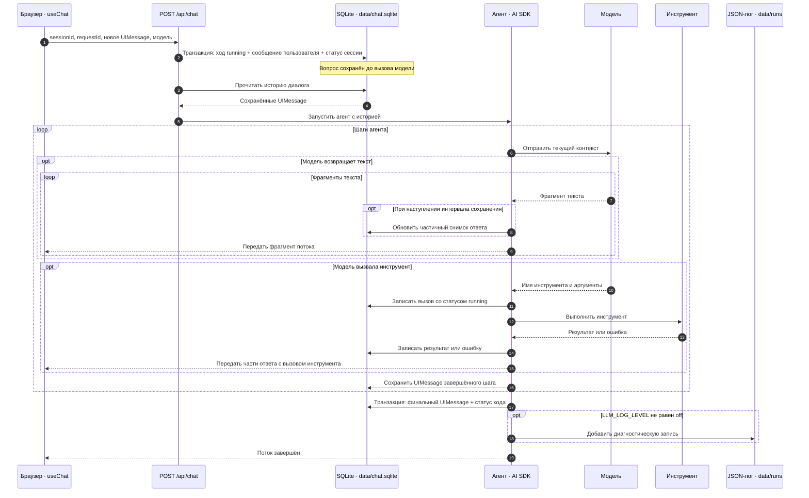

# Как сохраняется сессия чата

Пользовательская история хранится на сервере в `data/chat.sqlite`. Браузер использует `useChat` для показа текущего потока, но после обновления страницы загружает диалог из базы. Диагностические файлы `data/runs/run-*.json` существуют отдельно и не служат источником истории.

## Путь сообщения до полного ответа

Схема показывает один новый запрос пользователя. Вызов инструмента происходит только тогда, когда его запросила модель.

### Что происходит на каждом этапе

1. **Отправка.** `DefaultChatTransport` передаёт `sessionId`, новый `requestId`, выбранную модель и только новую пользовательскую реплику. Сервер проверяет запрос и сам читает прежнюю историю из SQLite. Массив истории от браузера не принимается. См. [`ChatWorkspace.vue`](../components/ChatWorkspace.vue), [`chat.ts`](../shared/chat.ts) и [`chat.post.ts`](../server/api/chat.post.ts).
2. **Начало хода.** В одной транзакции создаётся запись `turns` со статусом `running`, добавляется сообщение пользователя в `messages`, обновляются статус и ревизия `sessions`. Одинаковый `requestId` или второй выполняющийся ход в этой сессии отклоняется. Поэтому вопрос остаётся в истории, даже если модель не ответила. См. [`turn-repository.ts`](../server/persistence/turn-repository.ts).
3. **Сборка контекста.** Сервер читает сохранённые `UIMessage`, проверяет их и передаёт агенту. Контекст ограничен 100 сообщениями и 256 КиБ сериализованных данных. Превышение вызывает ошибку и не удаляет историю. См. [`session-context.ts`](../server/utils/session-context.ts).
4. **Поток текста.** Фрагменты ответа поступают в браузер по мере генерации. Сервер обновляет снимок частичного текста не чаще одного раза в секунду и сохраняет `UIMessage` после завершения шага агента. При аварии символы после последнего снимка могут отсутствовать. См. [`chat-agent.ts`](../server/agent/chat-agent.ts).
5. **Инструменты.** Обёртка записывает имя, аргументы и `tool_call_id` до исполнения инструмента. После исполнения она записывает результат или ошибку. Эти записи позволяют отличить подтверждённый результат от вызова, который мог прерваться посередине. См. [`recorded-tools.ts`](../server/agent/recorded-tools.ts).
6. **Завершение.** Финальный `UIMessage` и статусы хода и сессии сохраняются транзакционно. Статус бывает `completed`, `failed` или `interrupted` в зависимости от исхода потока. Если финальная запись не удалась, ход не помечается завершённым, хотя браузер мог уже показать текст ответа. Диагностический JSON-лог записывается отдельно и не влияет на сохранность истории. См. [`chat-agent.ts`](../server/agent/chat-agent.ts), [`turn-repository.ts`](../server/persistence/turn-repository.ts) и [`run-logger.ts`](../server/utils/run-logger.ts).

## Что хранится в SQLite

| Таблица | Данные | Зачем |
| --- | --- | --- |
| `sessions` | ID и название диалога, время создания, изменения и последнего открытия, статус, ревизия, `run_log_id` | Показать список чатов и открыть нужный диалог. |
| `turns` | `request_id`, порядок, статус, модель, `agent_config_json`, время начала и конца, ссылка на исходный ход при продолжении | Учитывать каждый запуск агента и его состояние. |
| `messages` | Порядок, роль, статус, версия формата и целый `UIMessage` в `payload_json` | Восстановить интерфейс и собрать контекст для следующего запроса. |
| `tool_executions` | ID вызова, имя, шаг, статус, вход, результат или ошибка | Разобраться, был ли инструмент выполнен и можно ли продолжать. |
| `dice_rolls` | `tool_call_id`, число граней, результат и время | Вернуть прежний результат при повторе того же вызова кубика. |

Схема таблиц, ограничения целостности и индексы определены в [`migrations.ts`](../server/persistence/migrations.ts). При чтении сообщения проверяются версия хранения и структура `UIMessage` в [`session-repository.ts`](../server/persistence/session-repository.ts).

## После прерывания и перезапуска

При запуске сервера ходы, оставшиеся в состоянии `running`, переводятся в `interrupted`; частичные ответы помечаются прерванными. Действие «Продолжить» создаёт **новый** ход из сохранённого контекста, а не восстанавливает прежнее соединение с моделью. Перед этим сервер проверяет неопределённые результаты инструментов и блокирует продолжение, если побочный эффект нельзя подтвердить. Во время продолжения инструменты, меняющие данные, отключены. См. [`chat-recovery.ts`](../server/plugins/chat-recovery.ts), [`turn-repository.ts`](../server/persistence/turn-repository.ts) и [`chat.post.ts`](../server/api/chat.post.ts).

Список сессий и выбранный диалог загружаются через `GET /api/sessions` и `GET /api/sessions/:id`. Для копии работающей базы используйте `npm run backup:chat`: скрипт применяет SQLite Backup API, поскольку при режиме WAL копирования одного файла `chat.sqlite` недостаточно. См. [`session-repository.ts`](../server/persistence/session-repository.ts), [`db.ts`](../server/persistence/db.ts) и [`backup-chat-db.mjs`](../scripts/backup-chat-db.mjs).
